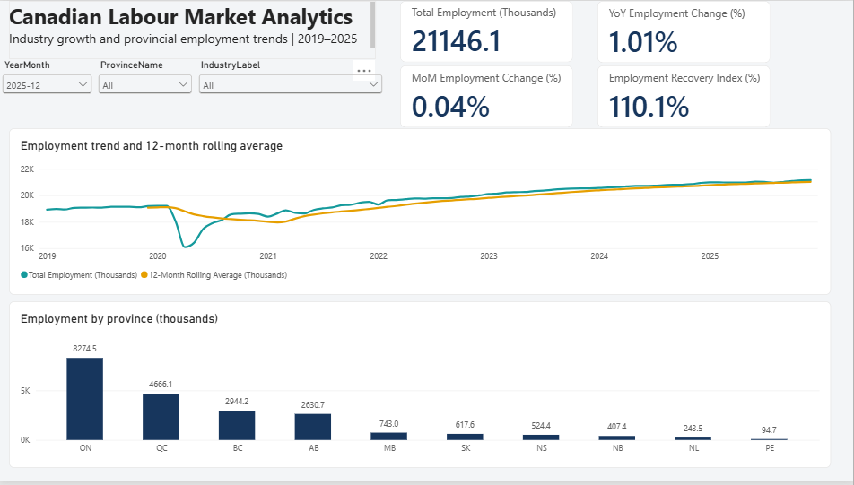
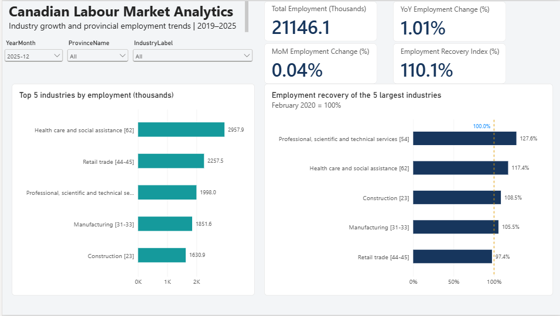

# Power BI report

The current application file is [Group3_PowerBI_Updated.pbix](Group3_PowerBI_Updated.pbix), updated on **November 25, 2026**. It contains **seven report pages**, including the two presentation pages shown below. The saved opening page is **Executive Overview.** (including the final period in the tab name).

## Open the report

1. Download the PBIX file using the link above. GitHub stores the file; it does not run the interactive report in its file preview.
2. Open the downloaded file in Power BI Desktop on Windows.
3. Start with **Executive Overview.**. For the screenshots below, select **YearMonth = 2025-12**, **ProvinceName = All** and **IndustryLabel = All**.
4. Open **Industry Size & Recovery** for the five largest industries, or use the other pages for detailed analysis.
5. To reconnect, refresh or rebuild the underlying MySQL database, follow the [database access and load instructions](../docs/D4_3_database_access.md).

A verified browser report URL and grader access are still pending. See the [D.4.3 task tracker](https://github.com/Ethannguye/BSMM8730-canadian-labour-market-analytics/issues/3) for the access status.

## Report pages

| Page | Purpose |
|---|---|
| Data Validation | Supporting data checks |
| Labour Market Overview | Overview of employment patterns |
| Industry Deep Dive | Detailed industry analysis |
| Province Industry Matrix | Province-by-industry comparison and drill-through entry |
| Employment Recovery | Employment trends relative to the February 2020 baseline |
| Executive Overview. | Selected-month KPIs, historical trend, rolling average and provincial comparison |
| Industry Size & Recovery | Employment and recovery of the five largest industries in the selected context |

## Presentation screenshots

The two PNG files are the original screenshots supplied from the team's Power BI session on November 25, 2026. Both show December 2025 with all provinces and all industries included in the analysis.

### Executive Overview

[Download the PNG](../docs/01_Executive_Overview.png)

### Industry Size & Recovery

[Download the PNG](../docs/02_Industry_Size_Recovery.png)

## Reading the figures

- Employment levels are measured in **thousands of employed persons**, for a selected reference month.
- YoY and MoM compare the selected month with the same month one year earlier and with the previous month, respectively.
- The recovery index uses **February 2020 = 100%**. An index of 110.1% means employment is approximately 10.1% above that baseline.
- The five industries are selected by **employment size**. Their recovery chart describes those same industries; it does not identify the five highest recovery indices across all industries.
- The historical overview line covers 2019–2025, while the cards and province bars describe the selected month.
- Source: **Statistics Canada, Labour Force Survey**; calculations and report visuals by Group 3. Dataset sources are linked in the [project README](../README.md#source-links).

## Earlier development screenshots

These earlier screenshots are retained as development evidence. Use the two presentation screenshots above for the latest overview pages.

## Earlier report archive

[Canadian_Labour_Market_Analytics_Group3.pbix..pbix.zip](Canadian_Labour_Market_Analytics_Group3.pbix..pbix.zip) is retained as an earlier archive. Use **Group3_PowerBI_Updated.pbix** for the current seven-page report.
